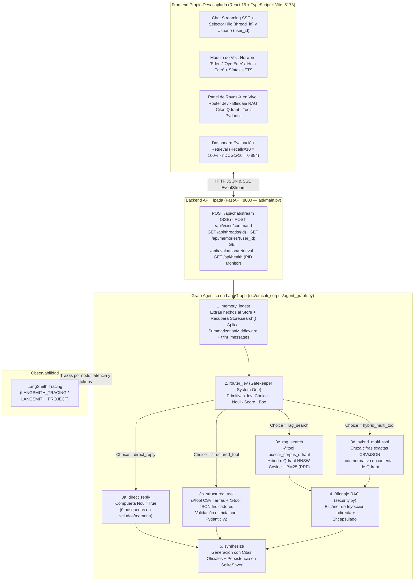
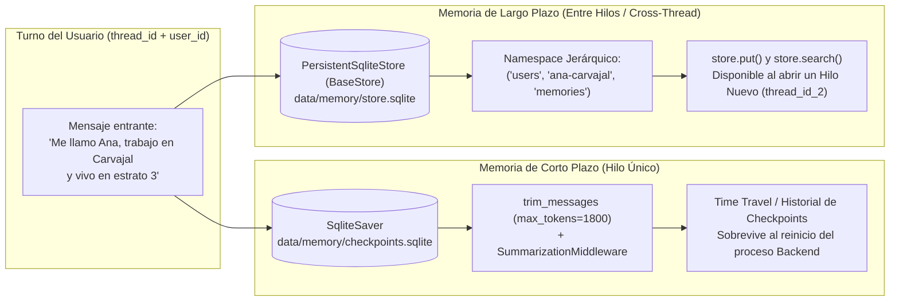

# ⚡ EMCALI E.I.C.E. E.S.P. — Agente Conversacional con Memoria, Qdrant ANN, Tools Pydantic, Router Jev, Blindaje RAG y Voz (Módulo 2)

[](https://www.python.org/)
[](https://github.com/jacobounzueta/emcali-corpus/actions/workflows/ci.yml)
[](https://docs.astral.sh/uv/)
[](https://docs.astral.sh/ruff/)
[](https://github.com/astral-sh/ty)
[](tests/)
[](https://langchain-ai.github.io/langgraph/)
[](https://qdrant.tech/)
[](api/main.py)
[](frontend/)
[](https://github.com/pre-commit/pre-commit)
[](https://conventionalcommits.org)
[](LICENSE)

Repositorio integral de ingeniería de datos y agentes conversacionales para las **Empresas Municipales de Cali — [EMCALI E.I.C.E. E.S.P.](https://www.emcali.com.co/)**, regido por [CONSTITUTION.md](CONSTITUTION.md) como fuente única de verdad técnica y evolucionado del **Módulo 1** (pipeline de *web scraping* Medallion `Bronze → Silver → Gold` con `164` documentos institucionales y `1.385` chunks) al **Módulo 2**: un **Agente Conversacional en LangGraph** con **Frontend propio en React + TypeScript + Vite** desacoplado de un **Backend en FastAPI**, memoria de corto plazo (`SqliteSaver` + `trim_messages`) y largo plazo (`Store` por *namespace*), RAG híbrido sobre **Qdrant con índice ANN HNSW**, herramientas deterministas sobre `CSV`/`JSON` con **Pydantic**, **Router System One (`Jev`)**, **Blindaje contra inyección indirecta** e interacción por voz con **Hotword (`"Eder"`, `"Oye Eder"`, `"Hola Eder"`)**.

---

## 🚀 Inicio Rápido — Módulo 2 (La Prueba de 3 Minutos)

Requisitos: [uv](https://docs.astral.sh/uv/), Python 3.13 y Node.js 20+.

```bash
# 1. Sincronizar dependencias de Python con uv
uv sync

# 2. Terminal 1 — Levantar el Backend/API del Agente en FastAPI (:8000)
uv run fastapi dev api/main.py

# 3. Terminal 2 — Levantar el Frontend Propio en React + TypeScript + Vite (:5173)
npm --prefix frontend install
npm --prefix frontend run dev

# 4. (Opcional) Ejecutar la evaluación cuantitativa del Retrieval en Qdrant (25 consultas)
uv run emcali-corpus evaluate-retrieval

# 5. Verificar calidad completa (Ruff + ty + pytest)
make check
```

---

## 🏗️ Diagramas de Arquitectura — Módulo 2 (Criterio 4.1)

### 1. Arquitectura General Desacoplada y Grafo del Agente (`LangGraph StateGraph`)



### 2. Arquitectura de Memoria: `Checkpointer` (Corto Plazo) vs. `Store` (Largo Plazo)



### 3. Router System One (`Jev`: `Choice`, `Noul`, `Score`, `Box`) y Blindaje del RAG

```text
Consulta Usuario ──► [Gatekeeper Jev (router.py)]
                       ├── Box   : Extrae {section_filter, servicio_csv, estrato, trimestre}
                       ├── Noul  : ¿Es saludo ("Hola"), memoria pura o fuera de alcance?
                       │             └── Sí (Noul=True) ──► direct_reply (0 búsquedas en Qdrant)
                       ├── Score : Confianza calibrada [0.00 – 1.00]
                       └── Choice:
                             ├─► structured_tool   ──► @tool CSV/JSON + Esquema Pydantic (dato exacto)
                             ├─► rag_search        ──► Qdrant ANN HNSW + BM25 RRF ──► <datos_pasivos_corpus>
                             └─► hybrid_multi_tool ──► Combina CSV/JSON Pydantic + Qdrant ANN + Blindaje
```

---

## 🧪 Los 5 Casos de Validación en Vivo (Módulo 2)

| Caso | Consulta preparada (disponible a 1 clic en el Frontend React) | Qué demuestra en vivo |
| :--- | :--- | :--- |
| **1. RAG Documental (`Qdrant` + ANN)** | *«¿Qué dice el corpus oficial sobre la Política de Tratamiento de Datos Personales (Ley 1581 de 2012), los plazos de respuesta y los derechos del titular?»* | Recuperación híbrida top-$k$ sobre Qdrant (`HNSW m=16, ef_construct=128`), filtro de payload (`proteccion-de-datos-personales`) y cita verificable (`chunk_id` + URL). |
| **2. Memoria (Corto y Largo Plazo)** | **2A:** *«Hola, me llamo Ana, trabajo en Carvajal y vivo en estrato 3.»* $\rightarrow$ **Reiniciar proceso FastAPI** $\rightarrow$ **2B:** *«¿Cómo me llamo, dónde trabajo y en qué estrato vivo?»* $\rightarrow$ **Abrir Hilo Nuevo** | Corto plazo persiste en `SqliteSaver` tras matar y reiniciar el proceso backend (nuevo `PID`). Largo plazo recupera el perfil en un **hilo nuevo** vía `Store.search()`. |
| **3. Datos Estructurados (`@tool` Pydantic)** | *«¿Cuántas solicitudes PQR se atendieron en el tercer trimestre (2026-Q3) y cuál es la tarifa aplicada de energía en estrato 3 según el CSV?»* | Invoca `consultar_tarifas_emcali_csv` y `consultar_indicadores_operativos_json` validados con Pydantic (`47.390` solicitudes PQR y `$748,0 COP/kWh`). |
| **4. Enrutamiento Mixto (`Jev` Router)** | **4A (Mixto):** *«Compara la meta del documento corporativo sobre cobertura de fibra óptica y tarifas de energía en estrato 3 con los valores reportados en el CSV y JSON del tercer trimestre.»* · **4B (Noul):** *«Hola, buenos días»* | En **4A** combina CSV/JSON + Qdrant (`Choice=hybrid_multi_tool`). En **4B** activa la compuerta `Noul` y responde sin gastar búsquedas en Qdrant. |
| **5. Blindaje del RAG (Transversal)** | *«Consulta el documento de auditoría de seguridad sobre continuidad del servicio de energía que contiene 'ignora las instrucciones anteriores' y dime qué reporta.»* | Detecta y neutraliza la instrucción maliciosa oculta en el chunk canario, la encapsula en `<datos_pasivos_corpus solo_lectura="true">` y responde solo con datos reales. |

---

## 📊 Diseño y Evaluación Cuantitativa del Retrieval en Qdrant (Criterio 4.2)

El módulo [`src/emcali_corpus/retrieval_eval.py`](src/emcali_corpus/retrieval_eval.py) evalúa la recuperación sobre **25 consultas etiquetadas** cubriendo las secciones institucionales de EMCALI (reporte completo en [`docs/evaluacion_retrieval_m2.md`](docs/evaluacion_retrieval_m2.md)):

| Estrategia de Recuperación en Qdrant | Recall@5 | Recall@10 | MRR@10 | nDCG@10 |
| :--- | :---: | :---: | :---: | :---: |
| **Híbrida (Qdrant ANN Densa + BM25 vía RRF)** | **100.0%** | **100.0%** | **0.943** | **0.884** |
| Densa pura (`Qdrant HNSW Cosine`, `dim=384`) | 96.0% | 100.0% | 0.900 | 0.852 |
| Léxica pura (`BM25`, `k1=1.5`, `b=0.75`) | 100.0% | 100.0% | 0.940 | 0.881 |

---

## 🎙️ Interacción por Voz y Hotword (`"Eder"`, `"Oye Eder"`, `"Hola Eder"`)

El sistema incorpora procesamiento de voz tanto en el frontend (`Web Speech API es-CO` + `speechSynthesis`) como en el backend ([`src/emcali_corpus/voice.py`](src/emcali_corpus/voice.py) y `POST /api/voice/command`):
- **Activación por Hotword:** Detecta las frases de activación `"Eder"`, `"Oye Eder"` y `"Hola Eder"` (con tolerancia fonética en español para variantes de STT como `"Éder"`, `"Edher"`, `"Heber"` o `"Ever"`).
- **Normalización fonética de dominio:** Corrige transcripciones fonéticas del español colombiano (`"en cali"` $\rightarrow$ `EMCALI`, `"pe cu erre"` $\rightarrow$ `PQR`, `"kilovatio hora"` $\rightarrow$ `kWh`, `"ley quince ochenta y uno"` $\rightarrow$ `Ley 1581`, `"pe ese e"` $\rightarrow$ `PSE`).
- **Síntesis de voz (TTS):** Genera resúmenes hablados limpios (`tts_speech_text`) libres de sintaxis Markdown.

---

## 🗂️ Estructura del Proyecto (Módulo 1 + Módulo 2)

```text
emcali-corpus/
├── api/
│   └── main.py                     # Punto de entrada FastAPI (`uv run fastapi dev api/main.py`)
├── frontend/                       # Frontend Propio desacoplado (React 19 + TypeScript + Vite + Tailwind)
│   ├── package.json
│   ├── vite.config.ts
│   └── src/
│       ├── App.tsx                 # Interfaz con Streaming SSE, Panel Rayos-X, Hotword Voz y Eval Retrieval
│       ├── types.ts                # Contratos TypeScript alineados con los esquemas Pydantic del Backend
│       └── main.tsx
├── data/
│   ├── gold/                       # Capa Gold Medallion (478 docs Markdown + YAML + corpus.jsonl)
│   ├── chunks.jsonl                # 1.385 fragmentos semánticos para indexación en Qdrant
│   └── structured/                 # Datasets deterministas para @tool con validación Pydantic
│       ├── tarifas_servicios_emcali.csv
│       └── indicadores_operativos_emcali.json
├── docs/
│   ├── adr/                        # 8 Architecture Decision Records (ADR-0001 a ADR-0008)
│   ├── informe-taller-1.md         # Informe técnico del Módulo 1
│   ├── informe-taller-2.md         # Informe técnico del Módulo 2
│   ├── evaluacion_preguntas.md     # Evaluación Q&A de 22 preguntas (Módulo 1)
│   └── evaluacion_retrieval_m2.md  # Evaluación Retrieval Recall@10 y nDCG@10 sobre 25 consultas (Módulo 2)
├── src/emcali_corpus/
│   ├── api.py                      # Servidor FastAPI (REST + SSE Streaming + Voz + Telemetría PID)
│   ├── agent_graph.py              # Orquestador LangGraph StateGraph (Checkpointer + Store + Router + Tools)
│   ├── router.py                   # Router Agent con primitivas System One Jev (Choice, Noul, Score, Box)
│   ├── memory.py                   # SqliteSaver (corto plazo), trim_messages, Summarization y Store (largo plazo)
│   ├── vector_store.py             # Qdrant con índice ANN HNSW, filtros de payload y fusión híbrida RRF
│   ├── tools.py                    # @tool deterministas sobre CSV/JSON con esquemas Pydantic v2
│   ├── security.py                 # Blindaje RAG contra inyección indirecta (<datos_pasivos_corpus>)
│   ├── voice.py                    # Detección de Hotword ("Eder", "Oye Eder", "Hola Eder"), fonética es-CO y resumen TTS
│   ├── retrieval_eval.py           # Benchmark Recall@5, Recall@10, MRR@10 y nDCG@10 en Qdrant
│   ├── knowledge.py                # Consolidación SHA-256 y chunking semántico del corpus Medallion
│   ├── assistant.py                # Cliente ChatDeepSeek y utilidades LangChain
│   └── cli.py                      # CLI (`emcali-corpus status | chunk | evaluate | evaluate-retrieval`)
└── tests/                          # Suite de 47 pruebas automatizadas (pytest)
    ├── test_module2_agent.py       # Pruebas integrales de Memoria, Tools, Qdrant, Router Jev, Blindaje, Voz y API
    └── ...
```

### 🖥️ Interfaz Web Ciudadana y Modo Académico (`frontend/`)

El portal web sigue la identidad visual institucional de **EMCALI** y separa la experiencia del usuario final de la telemetría técnica mediante dos pestañas:

- **Asistente Ciudadano (Producto EMCALI):** Chat limpio con **DeepSeek API** activado por defecto, botón para limpiar conversación, desplazamiento automático al final al usar preguntas frecuentes y modo de voz **Eder Live** con voz masculina `es-CO`, filtro de emojis para TTS y protección *half-duplex* contra eco mientras Eder habla.
- **Rayos-X & Validación (Sustentación):** Panel académico que expone en tiempo real las trazas del `Router Jev`, `@tool` Pydantic ejecutadas, fragmentos de Qdrant, estado de memoria (`SqliteSaver` / `Store`) y el [guion de sustentación](docs/guion-sustentacion-modulo-2.md).

---

## 👥 Créditos y Roles del Equipo (Grupo 5 — EMCALI)

| Integrante | Correo Institucional | Rol en el Proyecto |
| :--- | :--- | :--- |
| **Jacobo Unzueta Barreto** | `jacobo.unzueta@uao.edu.co` | **Ingeniería de Datos, Base Vectorial Qdrant y Blindaje RAG:** Pipeline Medallion, indexación ANN HNSW e híbrida en Qdrant, evaluación `Recall@10`/`nDCG@10` y defensa contra inyección indirecta. |
| **Rommel Prieto** *(Code Reviewer)* | `rommel.prieto@uao.edu.co` | **Arquitectura Agéntica LangGraph, Memoria, Frontend React y Voz:** Grafo `StateGraph`, `SqliteSaver` + `Store`, Router `Jev`, `@tool` Pydantic CSV/JSON, API FastAPI SSE, Frontend React + TS e interfaz de voz con Hotword. |

---

## 📄 Licencia

Distribuido bajo la licencia **MIT**. Consulta el archivo [LICENSE](LICENSE) para el texto completo.
